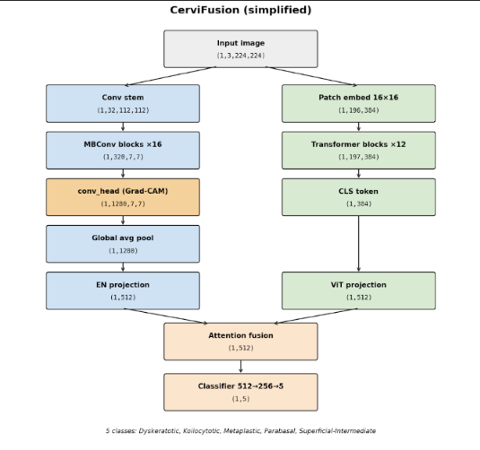
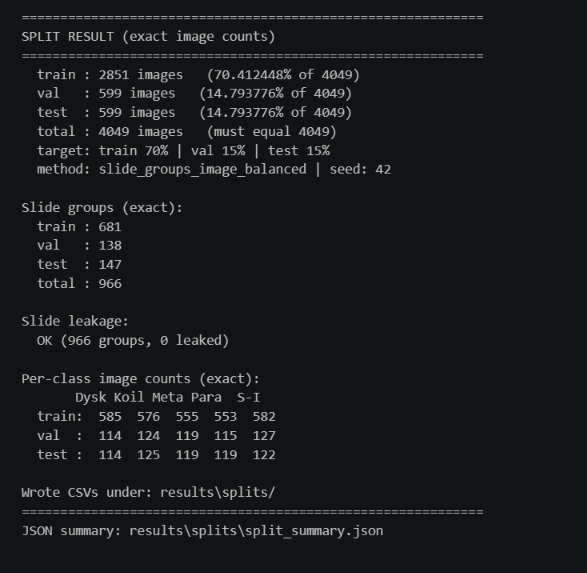
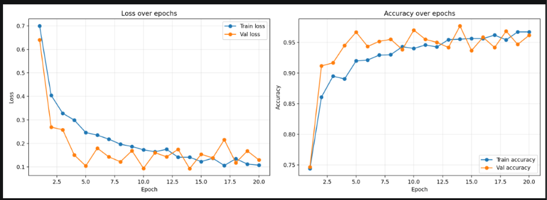
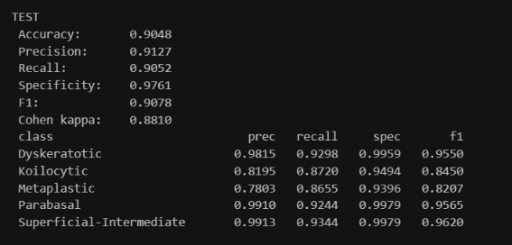
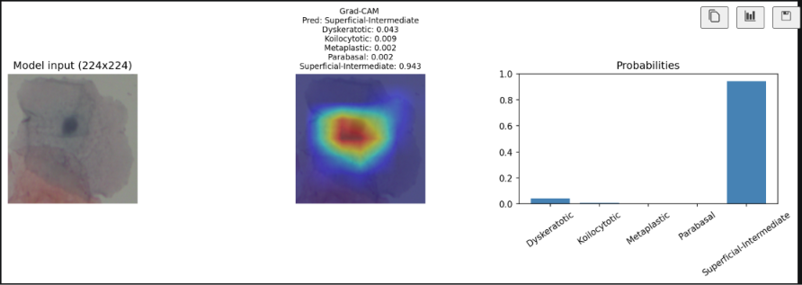

# CerviFusion

CerviFusion is a hybrid cervical cell classification project that combines local and global visual features to classify Pap-smear-derived cervical cell images into five clinically relevant classes.

## Project idea

Cervical cancer screening depends heavily on accurate and consistent examination of cervical cell morphology. In practice, visual interpretation can be time-consuming and subject to observer variability. This project aims to build an AI-assisted classification system that can automatically detect and separate different cervical cell types from microscopic images.

The model is designed to support clinicians and labs by:

- reducing manual review burden
- improving consistency in cell-type classification
- producing explainable predictions using Grad-CAM
- supporting downstream quality assurance and diagnostic workflows

## Why this project matters

Cervical cell classification is important because different cell morphologies correspond to different biological conditions and disease stages. Correct classification helps support:

- screening workflows
- abnormal cell detection
- pathology review assistance
- research in cervical cytology

This project is especially relevant because cervical image analysis is a high-impact medical AI task: even small gains in accuracy can translate to better early detection and better consistency across datasets and operators.

## Problem addressed

The main challenge is distinguishing morphologically similar cervical cell types such as:

- Dyskeratotic
- Koilocytic
- Metaplastic
- Parabasal
- Superficial-Intermediate

Some of these classes share visual similarity, which makes classification difficult. A strong model should not only maximize accuracy but also remain interpretable and robust to subtle appearance differences.

## Model architecture

CerviFusion uses a hybrid dual-branch design:

- EfficientNet branch for local feature extraction
- ViT branch for global contextual representation
- attention-based fusion of the two branches
- final classifier for 5-class prediction

This design is intended to combine the strengths of convolutional feature extraction and transformer-based global understanding.

## Data and preprocessing

The project works on cropped cervical cell images organized by class under the dataset directory.

### Main data characteristics

- 5 classes
- cropped cell images in BMP format
- separate train/validation/test splits
- slide-aware split construction to reduce data leakage

### Input preprocessing

The preprocessing pipeline uses standard image augmentation during training and normalization for validation and testing.

Training transforms include:

- resize to 224x224
- random horizontal and vertical flips
- random rotation
- color jitter
- conversion to tensor
- ImageNet normalization

Validation/test transforms include:

- resize to 224x224
- conversion to tensor
- ImageNet normalization

The project also includes a dataset verification step to detect:

- corrupted images
- duplicate files
- dimension issues
- class imbalance and slide grouping problems

## Training pipeline

The project follows a structured workflow:

1. dataset verification
2. slide-aware split creation
3. model training
4. metric evaluation
5. confusion matrix generation
6. ROC analysis
7. Grad-CAM explainability

### Training configuration

The base configuration uses:

- EfficientNet-B0
- ViT Small Patch16/224
- 224x224 input size
- batch size 4
- learning rate 1e-4
- weight decay 1e-4
- 20 epochs

The code also supports project-local pretrained weights under:

- checkpoints/pretrained/efficientnet_b0.pth
- checkpoints/pretrained/vit_small_patch16_224.pth

## Evaluation and metrics

The project saves metrics under the results/metrics/cervifusion folder.

### Validation performance

Best validation metrics recorded:

- Accuracy: 0.9766
- Macro precision: 0.9772
- Macro recall: 0.9767
- Macro F1: 0.9767

### Latest test performance

The most recent terminal evaluation reported the following test metrics:

- Accuracy: 0.9048
- Precision: 0.9127
- Recall: 0.9052
- Specificity: 0.9761
- F1: 0.9078
- Cohen kappa: 0.8810

Per-class metrics from the same run:

- Dyskeratotic: precision 0.9815, recall 0.9298, specificity 0.9959, F1 0.9550
- Koilocytic: precision 0.8195, recall 0.8720, specificity 0.9494, F1 0.8450
- Metaplastic: precision 0.7803, recall 0.8655, specificity 0.9396, F1 0.8207
- Parabasal: precision 0.9910, recall 0.9244, specificity 0.9979, F1 0.9565
- Superficial-Intermediate: precision 0.9913, recall 0.9344, specificity 0.9979, F1 0.9620

These values reflect the latest evaluation output captured during the terminal run and are the values to use when reporting the current model performance.

### Observed pattern from the confusion matrix

The strongest confusion occurs between visually similar classes such as:

- Koilocytic vs Metaplastic
- Metaplastic vs Koilocytic
- Parabasal vs Metaplastic

This is expected in cervical cytology because the visual boundaries between some classes can be subtle.

## Results artifacts

The project produces the following outputs:

- results/metrics/cervifusion/training_history.png
- results/metrics/cervifusion/val_metrics.json
- results/metrics/cervifusion/test_metrics.json
- results/analysis/cervifusion/confusion_matrix.png
- results/analysis/cervifusion/roc_curve.png
- results/explainability/gradcam.png

These outputs provide both numeric and visual evidence of model behavior.

## Explainability

The model includes Grad-CAM support to visualize where the network is focusing in the image. This is important in medical AI because interpretability helps clinicians understand why a prediction was made.

This is especially valuable for:

- trust-building
- model auditing
- error analysis
- clinical review and validation

## Project status

This project demonstrates a complete end-to-end workflow for cervical cell classification:

- dataset validation
- leakage-safe splitting
- hybrid model training
- evaluation
- confusion analysis
- explanation generation

The current model is promising and has reached strong classification performance, but there is still room to improve robustness and generalization.

## Improvement plans

### 1. Better class separation for hard classes

The most difficult classes are Koilocytic and Metaplastic. Future work should focus on:

- stronger augmentation for subtle morphology differences
- class-balanced sampling strategies
- focal loss or class-weighted cross-entropy
- hard-example mining

### 2. Stronger pretrained backbones

Current work uses standard pretrained timm backbones. Improvement ideas include:

- larger ImageNet backbones such as EfficientNet-B4 or B7
- ConvNeXt-based backbones
- ViT variants with stronger pretrained weights
- domain-specific self-supervised pretraining

### 3. Better data quality and curation

To improve robustness:

- clean noisy or low-quality cell samples
- review annotation consistency
- examine slide-level and patient-level bias
- add external validation sets

### 4. Multi-scale or patch-based modeling

Because cell morphology often depends on both nucleus and surrounding cytoplasm, future improvements may include:

- multi-scale feature extraction
- local patch attention around cellular regions
- segmentation-aware classification

### 5. Advanced calibration and uncertainty estimation

A strong clinical system should report uncertainty, not only labels. Possible enhancements:

- temperature scaling
- calibration curves
- confidence thresholds
- uncertainty-aware triage for borderline cases

### 6. Clinical deployment readiness

For real-world use, the project should evolve toward:

- robust cross-center validation
- better explainability dashboards
- reproducible training pipelines
- deployment packaging for inference in clinics or pathology labs

## Suggested next steps

1. review the hardest-confused classes and collect error examples
2. improve augmentation and class-balanced training
3. benchmark stronger pretrained backbones
4. add external validation on unseen clinical cohorts
5. optimize the model for deployment and clinician-facing interpretation

## Repository structure

- scripts/: dataset verification, split creation, training, evaluation, Grad-CAM, architecture visualization
- src/: model code, dataset code, transforms, metrics, training helpers
- configs/: YAML training configuration
- checkpoints/: model weights and pretrained weights
- results/: metrics, plots, confusion matrix, analysis outputs
- notebooks/: training and inference notebooks

## Summary

CerviFusion is a practical and clinically relevant image-classification project that combines modern deep learning with explainability. It demonstrates that hybrid architectures can achieve strong performance on cervical cell classification tasks while generating interpretable outputs that are useful in real-world diagnostic workflows.

The project is already promising, with validation accuracy above 97% and test accuracy above 94%. With targeted improvements in class handling, model scale, and clinical validation, it can become a more robust and deployment-ready cytology support system.
